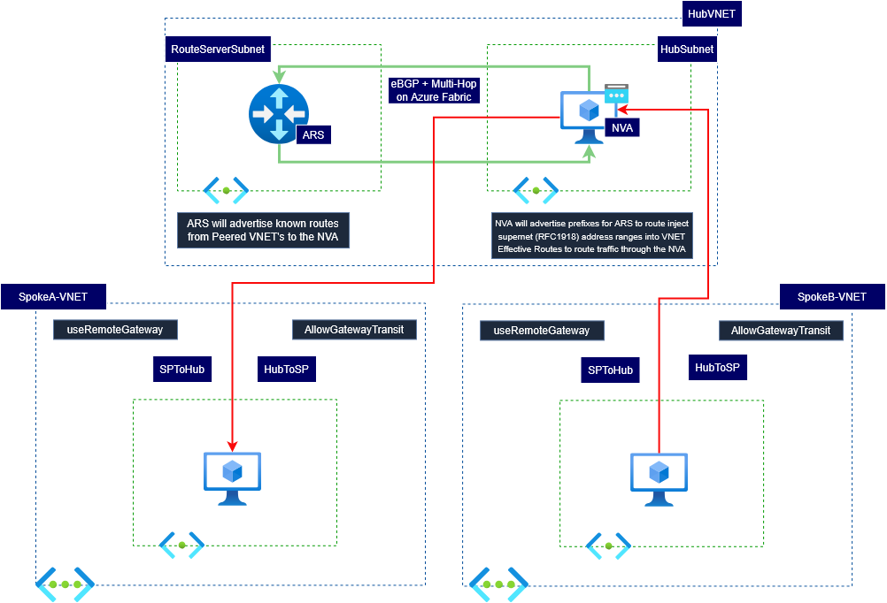
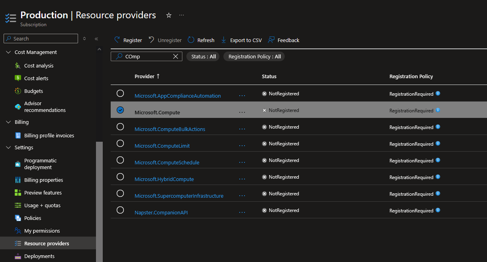

# NB/SB Firewall Setup with Pfsense Network Virtual Appliance

## Architecture



### Pfsense as a BGP Peer

In this demonstration, we will utilize Route Maps to allow Pfsense as a BGP Peer to advertise a set of RFC1918 Private IP Address ranges to Azure Route Server. Once the Route Map is in place, Pfsense will then be configured to distribute our desired network address ranges defined in `Networks to Distribute`.

> **Route maps** can control, for example, whether specific routes are accepted from neighbors, or whether specific routes are **distributed to neighbors**. [Pfsense](https://docs.netgate.com/pfsense/en/latest/packages/frr/global/routemaps.html#dynamic-routing-route-maps)

*we will only be using a basic catch all definition for our Route Map, allowing for any of our definitions to be advertised.*

Once the routes are distributed to the configured neighbors (Azure Route Server) since `allowGatewayTransit` is enabled from Hub to Spoke network Peerings, Azure Route Server will be able to propogate the advertised routes from Pfsense and inject the routes into each VNET gateway and the subsequent VM effective routes. Note that also `useRemoteGateway` is enabled from Spoke to Hub peerings, which is required for Azure Route Server to be able to dynamically modify the route tables.

### Hub & Spoke

**Hub -> Spoke Peering Configurations**
```
allowForwardedTraffic: true
allowVirtualNetworkAccess: true
allowGatewayTransit: true // Allow for Route Server Propagation to Spokes
useRemoteGateways: false
```

**Hub <- Spoke Peering Configurations**
```
allowForwardedTraffic: true
allowVirtualNetworkAccess: true
allowGatewayTransit: false
useRemoteGateways: true // Allow Routes from Route Server
```
Reference: https://learn.microsoft.com/en-us/azure/route-server/route-injection-in-spokes

VNET Spoke Networks

## Pre-requisite Steps

1. Prior to beginning the lab, please create a **Subscription** to store the following resources.

2. Ensure that Microsoft.Compute is registered within your subscription to be able to provision virtual machines.



3. Accept the EULA for the `pfsense` image:

```
az vm image accept-terms --plan pfsense-plus-public-tac-lite --offer pfsense-plus-public-cloud-fw-vpn-router --publish netgate
```

## Setup
**Prior to running the deploy script, take note of the ASN Number and static IP that will be assigned to Pfsense. These values will be utilized as parameters for setting up BGP Peering between Azure Route Server when configuring the Pfsense dashboard.**

By default the deployment sets the following values:
```
IP Address: 10.0.1.10
ASN: 65014
```


1. Run the `deploy.sh` script to apply the bicep configuration

## Post-Setup Instructions

1. Access the Virtual Machine via the public IP Address
    - Login with the following credentials: `pfsenseadmin` `$(cat /tmp/gwpasswd)`

2. In the setup wizard configure the following settings.
    ```
    IP Address: 10.0.1.10
    Subnet Mask: 24
    Upstream Gateway: 10.0.1.1
    ```

3. Download FRR
    
    On the Pfsense dashboard navigate to `System > Package Manager` then search for the `frr` package and proceed with the installation.

4. Configure BGP Peering

    First add an `ALLOW-ALL` Route Maps for BGP.
    
    1. Services > FRR Global/Zebra, Route Maps
        ```
        Name: ALLOW-ALL
        Description: Match any route
        Action: Permit
        Sequence: 100
        ```
    Then add as Master password string for FRR.
    1. [Global Settings]
        ```
        Enable: Check
        Master Password: <string>
        ```

    On the PFSense Page configure the 2 high availability neighbors provided by Azure Route Server to peer to. The following settings should be updated.

    **BGP Configuration**
    ```
    Enable: Check
    Local AS: <pfsense-AS-number>
    Router ID: <ipv4-address>
    Networks to Distribute:
    - 0.0.0.0/0
    - 10.0.0.0/8
    - 172.16.0.0/12
    - 192.168.0.0/16
    ```

    **Neighbor Configuration**

    Per each Neighbor (ex: 10.0.2.4, 10.0.2.5) add the following configuration:
    ```
    Name/Address: <bgp-neighbor-ipv4-address>
    Remote AS: <azure-route-server-as-number>
    EBGP Multi-Hop: 5
    Inbound Route Map: ALLOW-ALL
    Outbound Route Map: ALLOW-ALL
    ```
5. Firewall Configuration

    Create an alias called `AZURE_PRIVATE_NETWORKS` and add the following address ranges:
    ```
    - 10.0.0.0/8
    - 172.16.0.0/12
    - 192.168.0.0/16
    ```

    Add the firewall rule referencing the Alias. This will allow east-west traffic between the private spoke networks.
    - Firewall -> Rules -> WAN -> Add
    ```
    Action: Pass
    Interface: WAN
    Address Family: IPv4
    Protocol: Any
    Source: Address or Alias & AZURE_PRIVATE_NETWORKS
    Destination: Address or Alias & AZURE_PRIVATE_NETWORKS
    ```

6. BGP Validation

    Validate the BGP Peering at Services -> FRR BGP -> Status. The peers should be communicating with each other.

    ```
    IPv4 Unicast Summary:
    BGP router identifier 10.0.1.10, local AS number 65014 VRF default vrf-id 0
    BGP table version 10
    RIB entries 10, using 1280 bytes of memory
    Peers 2, using 33 KiB of memory

    Neighbor        V         AS   MsgRcvd   MsgSent   TblVer  InQ OutQ  Up/Down State/PfxRcd   PfxSnt Desc
    10.0.2.4        4      65515       107        96       10    0    0 01:31:36            3        7 N/A
    10.0.2.5        4      65515       108        97       10    0    0 01:31:26            3        7 N/A

    Total number of neighbors 2
    ```

### Spoke to Spoke Validation

```
Host A
sudo tcpdump -ni any 'icmp and host <spoke-b-vm-ipv4>'

Host B
ping <host-a-ipv4>
```

### Configuring WireGuard Access for PFSense

## Additional Information

Query the PFSense NVA Image
```bash
az vm image list \
  --publisher netgate \
  --location eastus2 \
  --all \
  --output table
```

## Citations

BGP Advertising: https://www.dasblinkenlichten.com/bgp-route-advertisements/
VNET's in Azure: https://blog.cloudtrooper.net/2023/02/06/virtual-network-gateways-routing-in-azure/